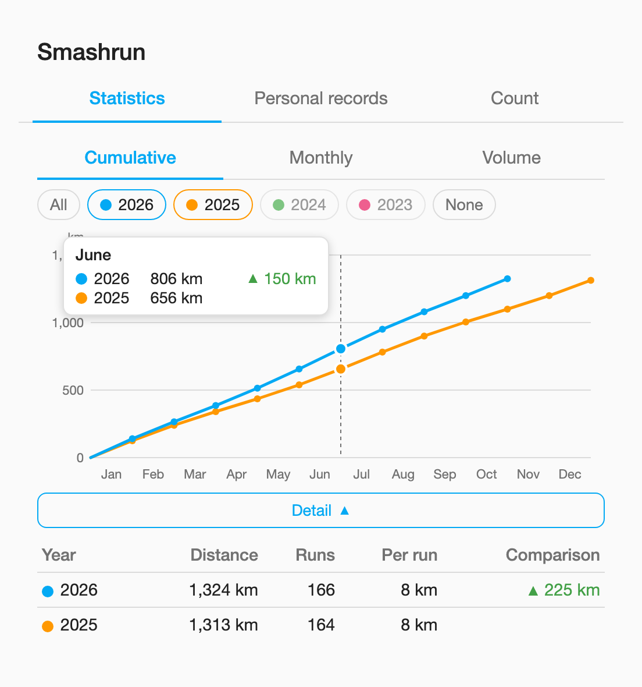
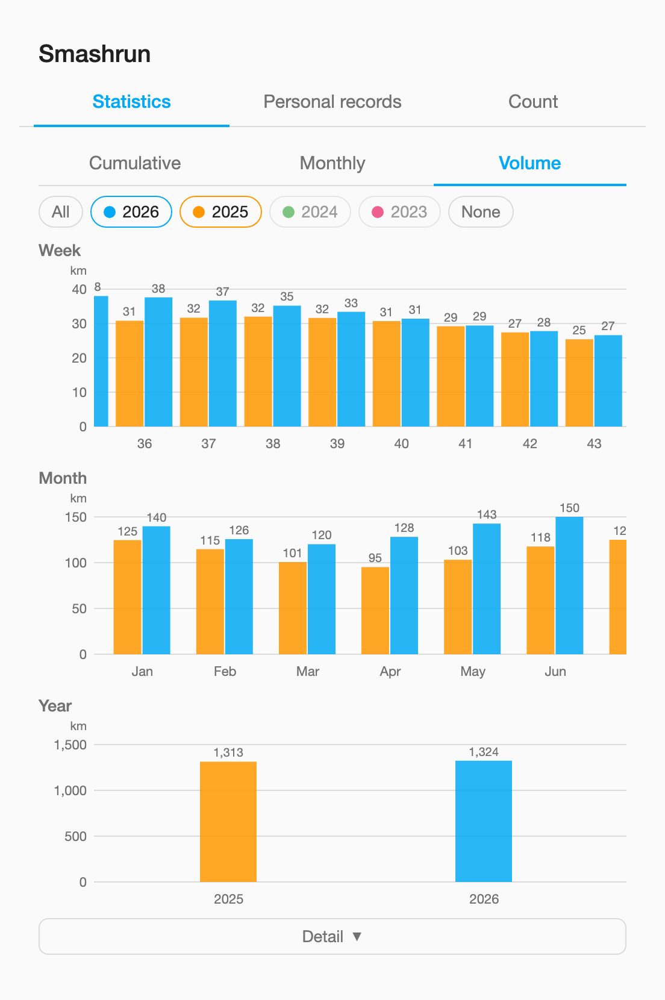
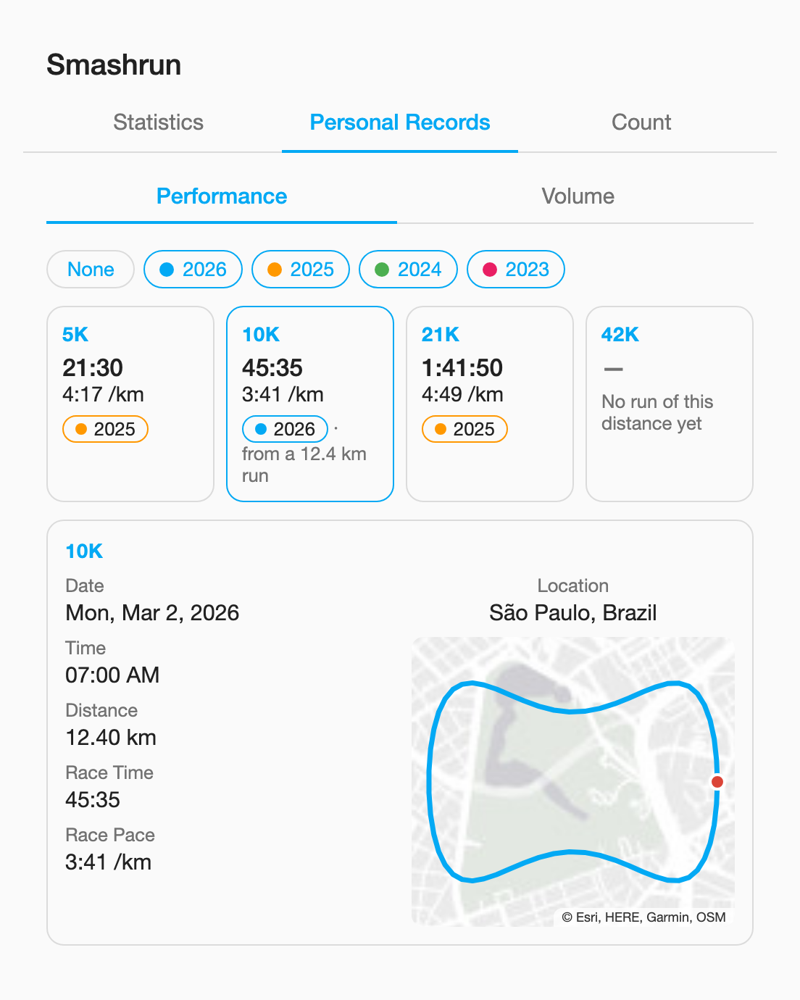
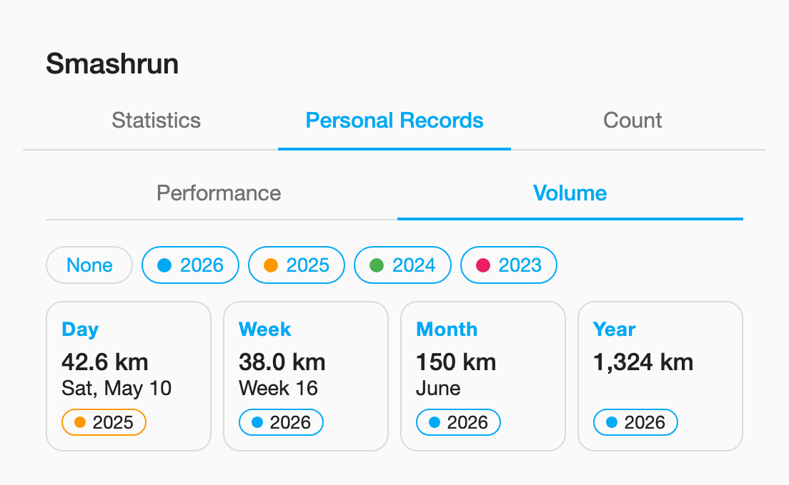
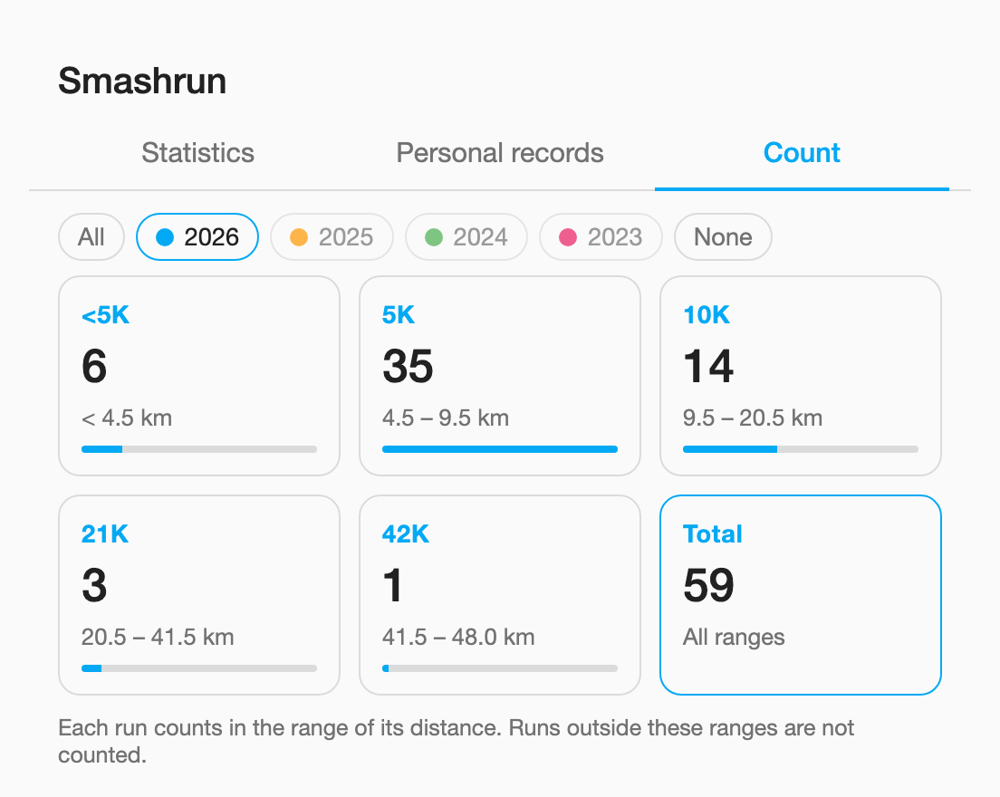
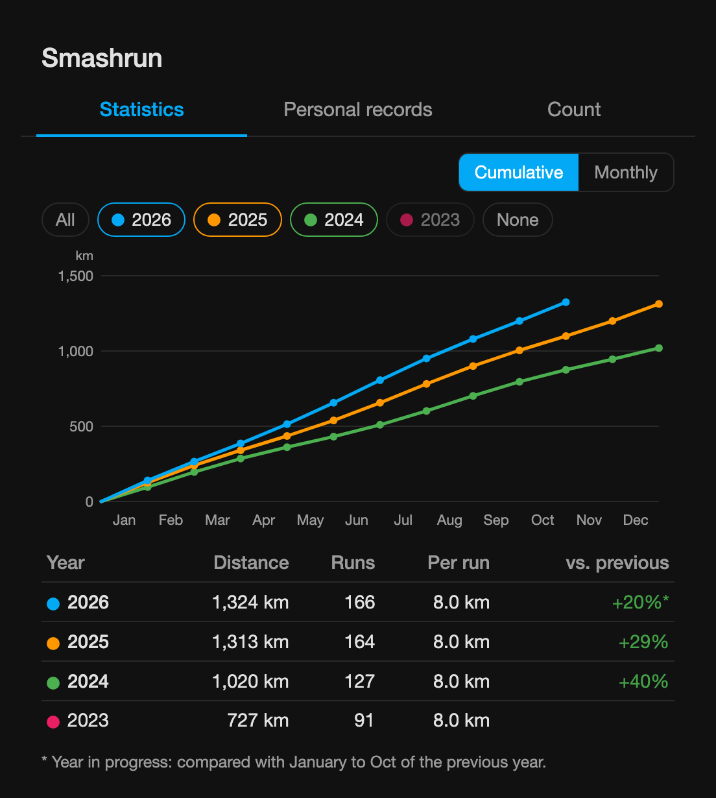
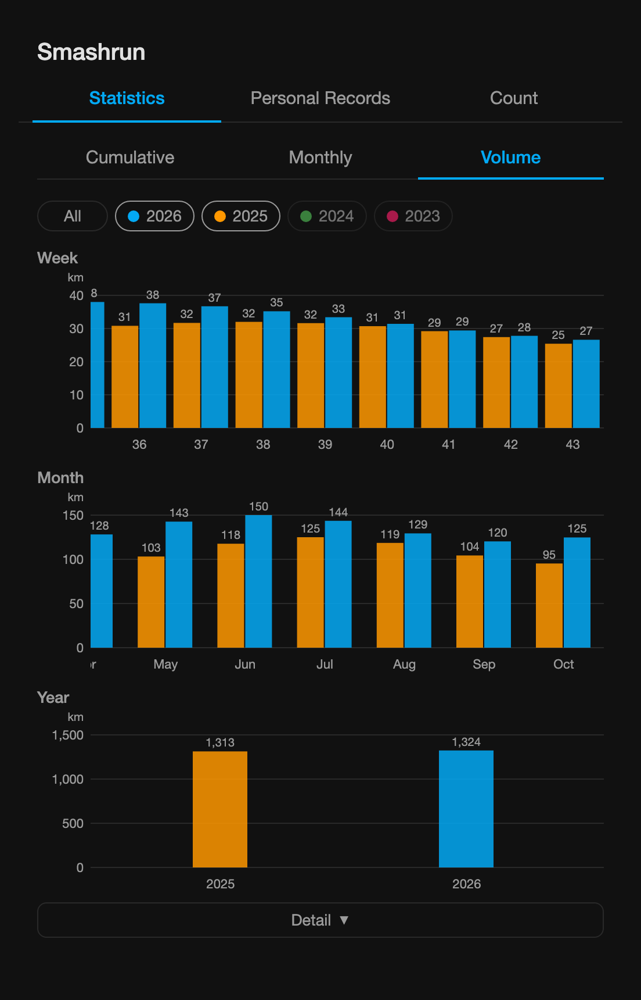
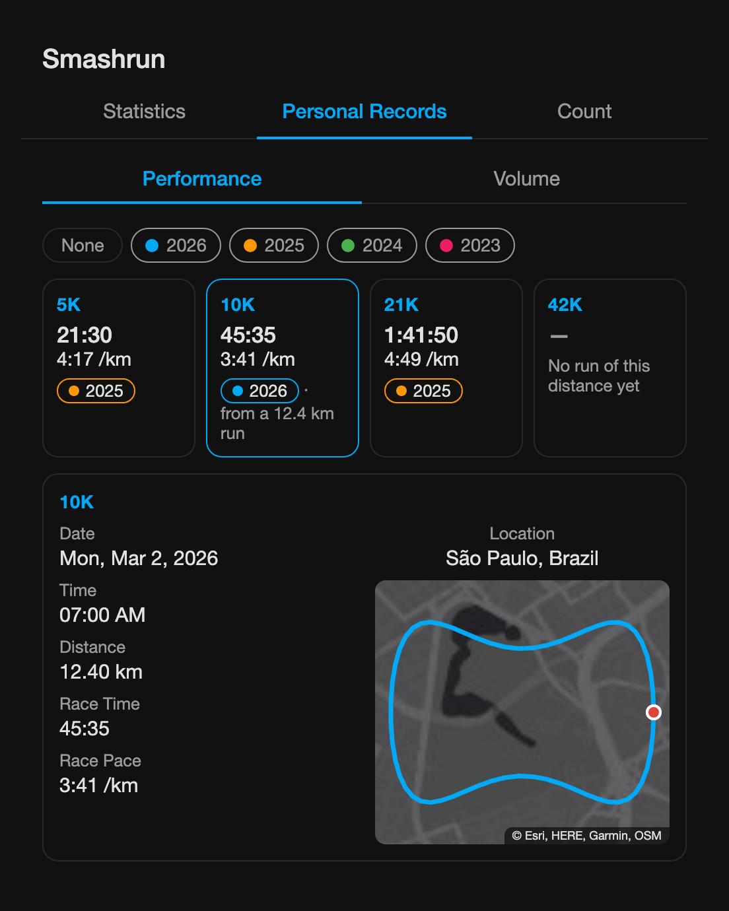
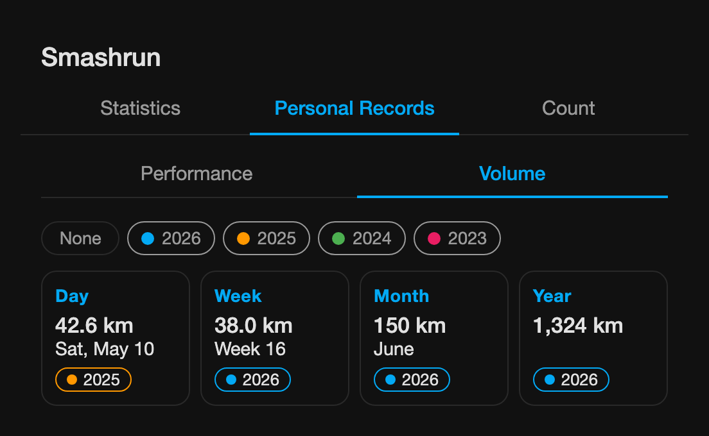
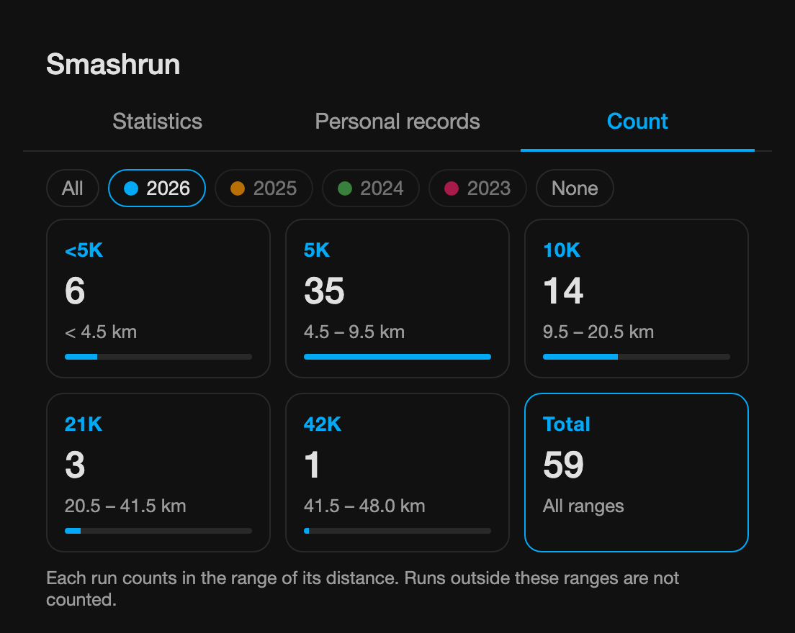

# Smashrun for Home Assistant

Custom integration (HACS) that brings your **Smashrun** runs into Home Assistant: your last run (distance, duration, pace, max heart rate, elevation), your whole run history (totals, weekly/monthly/yearly distance, a calendar of every run and long-term statistics back to your first run) and your badge count.

It uses the official [Smashrun API](https://api.smashrun.com/) with a **personal access token**, read-only (`read_activity` scope). No API key or password is needed.

## How it works

Every 30 minutes (configurable) Home Assistant asks Smashrun for your latest run. Only when a new run shows up (and once a day, to pick up edits and deletions) does it read the full run list and your badges again. A run appears in Home Assistant after it has synced to Smashrun.

## Signing in

The integration reads Smashrun with a **personal access token**, which lasts about 60 days. The setup offers two ways to get it:

- **Email and password** (recommended): Home Assistant signs in with them to get the token, and gets a new one by itself **7 days before** it expires, so at most **53 days** after the last one (a token is taken to last 60 days, or less if Smashrun says so), and whenever Smashrun rejects it, so you never paste tokens. If the password stops working (for example after you change it on Smashrun), Home Assistant shows a **Reauthenticate** notice asking for it again.
  - The email and password are saved in Home Assistant's configuration (`.storage/core.config_entries`), like other integrations that sign in with a password; diagnostics redact them.
  - This uses the login service behind Smashrun's own authorization page (the one below), which is not part of Smashrun's documented API. If Smashrun changes it, switch to a pasted token in **Reconfigure**.
- **Paste a token**: get it yourself as described below and paste it; when it expires, paste a new one.

**Settings → Devices & services → Smashrun → ⋮ → Reconfigure** switches between the two, or updates the email/password or the token.

### Getting a personal access token by hand

1. Sign in to <https://smashrun.com>.
2. Open this address: <https://secure.smashrun.com/oauth2/authenticate?client_id=client&scope=read_activity&response_type=token&redirect_uri=urn:ietf:wg:oauth:2.0:oob> (the setup form has the same link).
3. Allow access. Smashrun shows the access token, or puts it in the address bar after `access_token=`.
4. Copy it. You can paste the token alone or the whole address: the integration extracts the token.

Personal tokens **expire after about 60 days** and cannot be refreshed through the API (Smashrun only allows that for registered apps): with a pasted token, when it expires Home Assistant shows a **Reauthenticate** notice for the integration; repeat the steps above and paste the new token. To swap the token earlier, use **Reconfigure**. The **Token expires** sensor tells you when the current one stops working, so you can set up a reminder. Personal tokens are also limited to 250 API requests per hour, far above what the integration uses.

## Installation (HACS)

[](https://my.home-assistant.io/redirect/hacs_repository/?owner=jacardbr&repository=ha-smashrun&category=integration)

1. Click the button above, or add it by hand: **HACS → ⋮ → Custom repositories**, paste `https://github.com/jacardbr/ha-smashrun`, category **Integration**, then **Add**.
2. Search for **Smashrun** in HACS and download it.
3. **Restart Home Assistant.**
4. Go to **Settings → Devices & services → Add integration → Smashrun** and choose **Email and password** or **Paste a personal access token** (see [Signing in](#signing-in)). Leave **Import the whole run history** checked to fill the sensors' graphs with your past runs (see [Importing history](#importing-history)).

Manual installation (without HACS): copy `custom_components/ha_smashrun` to `<your /config>/custom_components/ha_smashrun` and restart.

## Options

**Configure** on the integration opens a menu with **Change update interval** (5 to 1440 minutes, default 30) and **Import history now**.

## Entities

### Last run

| Entity | Unit | Notes |
|---|---|---|
| Last run distance | km | |
| Last run duration | min | |
| Last run pace | | Text in minutes:seconds, e.g. `5:52 /km` (or `/mi`, following your Smashrun distance unit). The `minutes` attribute has the same pace in decimal minutes (5.87) for templates |
| Last run speed | km/h | Disabled by default |
| Last run max heart rate | bpm | Only if the run has heart rate data |
| Last run elevation gain | m | |

Distances and speeds are converted to miles automatically when Home Assistant uses US customary units.

### History

| Entity | Unit | Notes |
|---|---|---|
| Total distance | km | All runs ever |
| Total runs | runs | |
| Distance this week / month / year | km | The week starts on Monday |
| Runs this week / month / year | runs | Week and month disabled by default |
| **Runs** (calendar) | | One event per run, from start to finish, with distance, time, pace and a link to the run on Smashrun |

The calendar shows every run you ever logged, so you can browse your history in the Home Assistant calendar or use it in automations.

### Badges

| Entity | Notes |
|---|---|
| Badges | Number of badges earned. The `recent_badges` attribute lists the last 10 |

The badges endpoint is listed by Smashrun but its response format is not documented, so this sensor reads it defensively. If the endpoint is not available for your token, it shows as unavailable and the rest of the integration keeps working.

### Token

| Entity | Notes |
|---|---|
| Token expires | When the personal access token stops working (diagnostic). With the email and password saved, it is 60 days after the token was obtained (or earlier if Smashrun says so), renewed 7 days before; with a pasted token, it is checked once a day |

Example reminder a week before:

```yaml
automation:
  - alias: Smashrun token expiring
    triggers:
      - trigger: template
        value_template: >
          {{ states('sensor.smashrun_token_expires') not in ['unknown', 'unavailable']
             and as_datetime(states('sensor.smashrun_token_expires')) - now() < timedelta(days=7) }}
    actions:
      - action: persistent_notification.create
        data:
          title: Smashrun
          message: The Smashrun token expires in less than a week. Get a new one and use Reconfigure on the integration.
```

(Adjust the `entity_id` to the one shown in your Home Assistant.)

## Lovelace card

The integration ships a card and loads it automatically (no resource to add). Add it from the dashboard editor (search for **Smashrun**) or with:

```yaml
type: custom:ha-smashrun-card
```

It has three tabs:

- **Statistics:** distance through the year with one line per year, **cumulative** (the classic year-over-year comparison) or **monthly**, or **Volume**: three bar charts with the distance per **week** (ISO weeks, Monday to Sunday), per **month** and per **year**, one bar per selected year in its color, with its value above it. Charts wider than the card (the weeks, and the months with several years) scroll sideways with the axis fixed, and open at the current week and month. Hover over the line chart, or click (tap) a column of a bar chart, to see each year's distance in that month, week or year, newest year first; in the bar charts a second click, or a click elsewhere, closes it. Each year has a green arrow up or a red arrow down and the difference in km against the next older year shown; the oldest year shown is the baseline. Tap the year chips to choose which years are compared (the last two at first); the **All** button selects every year and, once they are all selected, turns into **None** to clear them, in every tab. Below the charts, the **Detail** button shows or hides (hidden at first) a table of the selected years with each one's distance, number of runs, distance per run and a **Comparison** with the next older year shown, as a green ▲ or red ▼ difference in km (the oldest year shown is the baseline); the year in progress is compared with the same months of the year below it (hover over the value to see which months).
- **Personal Records:** two views, with the same year chips. **Volume** shows the most kilometres in one **day** (all runs of the day added up), **week** (ISO, Monday to Sunday), **month** and **year**, each with its date or period and a tag of its year. **Performance** shows the fastest time and pace for **5K, 10K, 21K and 42K**, in the years selected with the same year chips as the Statistics tab (every year, that is all time, at first), with a tag of the record's year in that year's color, which links to the run (the date shows on hover). Click a tile to see its run below the tiles: date, start time, location (city, state and country), distance, race time, race pace, and the **route** drawn from its GPS track over a gray map (Esri's Light Gray or Dark Gray Canvas, following the theme; the `route_map` option turns the map off), with the start in green and the end in red. The location and the route are read from Smashrun the first time you open a run, then kept; click the tile again to hide it.
- **Count:** how many runs you did per distance, in the years selected with the year chips (only the latest year at first): **<5K** under 4.5 km, **5K** from 4.5 to 9.5 km, **10K** from 9.5 to 20.5 km, **21K** from 20.5 to 41.5 km and **42K** from 41.5 to 48 km (each range includes its start and excludes its end). Only ranges with runs in the selected years are shown, plus a **Total** tile that adds them up; each range's bar is its share of the total. Runs of 48 km or more are not counted. The ranges can be changed in the card options.

| Statistics | Statistics: Volume | Records: Performance | Records: Volume | Count |
|---|---|---|---|---|
|  |  |  |  |  |
|  |  |  |  |  |

_Screenshots with sample data, from `tests/card_test.html`._

Distances follow the Home Assistant unit system (km or mi) and the texts follow its language (English or Portuguese).

| Option | Default | |
|---|---|---|
| `title` | none | Card title |
| `default_tab` | `statistics` | `statistics`, `records` or `count` |
| `entry_id` | first account | Which Smashrun account, when more than one is configured |
| `route_map` | `true` | Show a gray map (Esri Light/Dark Gray Canvas) behind a record's route (`false`: the route alone) |
| `statistics_years` | `2` | Years selected at first in the Statistics tab (the latest ones; `0` = every year) |
| `records_years` | `0` | Years selected at first in the Personal Records tab |
| `count_years` | `1` | Years selected at first in the Count tab |
| `range_5k` | `4.5` | Count ranges, in km: where the 5K starts (the <5K range goes from 0 to here) |
| `range_10k` | `9.5` | Where the 10K starts |
| `range_21k` | `20.5` | Where the 21K starts |
| `range_42k` | `41.5` | Where the 42K starts |
| `range_max` | `48` | Where the 42K ends; longer runs are not counted |

All of them can be set in the card editor (the year and range options under **Years selected at first** and **Count ranges (km)**).

**How personal records are calculated.** The Smashrun API gives each run's total distance and time, but not its splits (reading the splits of every run would exceed the 250 requests per hour of a personal token). So each record comes only from **runs of that distance's range** (the same ranges as the Count tab, 9.5 to 20.5 km for the 10K by default, configurable in the card) that are **at least the distance**, up to 1% short for GPS, and it is the run's **real time and pace, as raced**: a marathon logged as 42.7 km in 3:53:46 is a 3:53:46 42K, and a half marathon only counts for the 21K.

## Importing history

Home Assistant only records a sensor from the moment it exists, so without help the graphs of **Total distance**, **Total runs** and the **this week / month / year** sensors would start on the day you add the integration.

The import fills in the past: it reads every run in your Smashrun account and writes the hourly long-term statistics of those sensors back to your first run. Statistics graphs then show, for example, your distance per week or month across your whole history, straight from the sensors.

- **At setup:** **Import the whole run history** is checked by default. It runs once, in the background, and unchecks itself when it finishes. If it fails (for example, no internet), it is retried the next time the integration loads.
- **Later:** **Configure → Import history now**, or the `ha_smashrun.import_history` action (optionally with `config_entry_id`).

Only the time **before** the recorder's own statistics for each sensor is written, and the imported values are aligned with them, so the totals do not jump at the boundary and it is safe to run the import more than once. Only enabled sensors are imported: if you enable **Runs this week** later, run the import again.

## External statistics (full history)

Independently of the import, the integration also keeps two statistics of its own with your **whole** history, from your first run:

- `ha_smashrun:distance_<your Smashrun id>`: distance (km)
- `ha_smashrun:runs_<your Smashrun id>`: number of runs

They are rebuilt whenever the run list changes. Use them with a **Statistics graph** card, for example the distance per week:

```yaml
type: statistics-graph
title: Distance per week
chart_type: bar
period: week
stat_types:
  - change
entities:
  - ha_smashrun:distance_123456
days_to_show: 365
```

Use `period: month` or `period: year` for other views. To find your id, open the card editor and search for "Smashrun", or look at **Developer tools → Statistics**.

## Diagnostics

**Settings → Devices & services → Smashrun → ⋮ → Download diagnostics** gives the raw API payloads of the last run, the first runs and the first badges (the token and names are redacted). Include it when reporting a problem.

## Development

The API client and the run helpers have tests that run with the standard library only:

```sh
python3 -m unittest discover -s tests -v
```

The card has a browser test (Chrome or Edge, headless):

```sh
"<browser>" --headless --disable-gpu --dump-dom --virtual-time-budget=8000 \
  "file://$PWD/tests/card_test.html" | grep -o 'RESULT: [A-Z]*[^<]*'
```

A headless run skips the auto-scroll check, which needs a browser that draws frames; opening the page in a browser runs it too.

Open `tests/card_test.html?demo=statistics` (or `records`, `count`; add `&mode=volume` or `&rmode=volume` for the Volume views; add `&lang=pt-BR`, `&theme=dark`, `&units=mi`, `&w=340`) to see the card with sample data.
